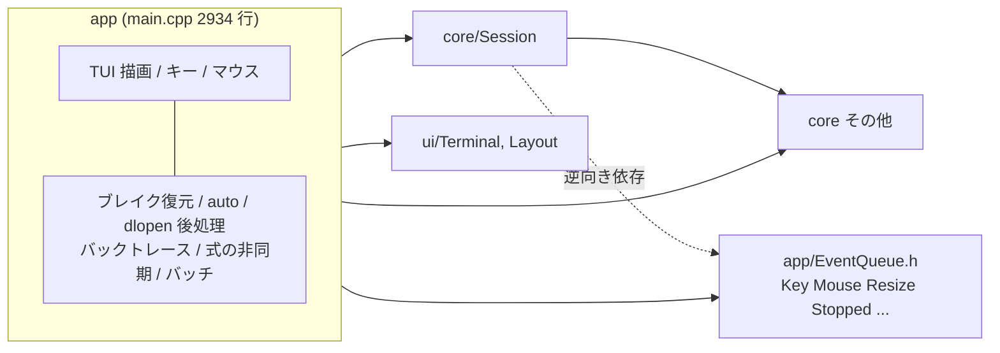
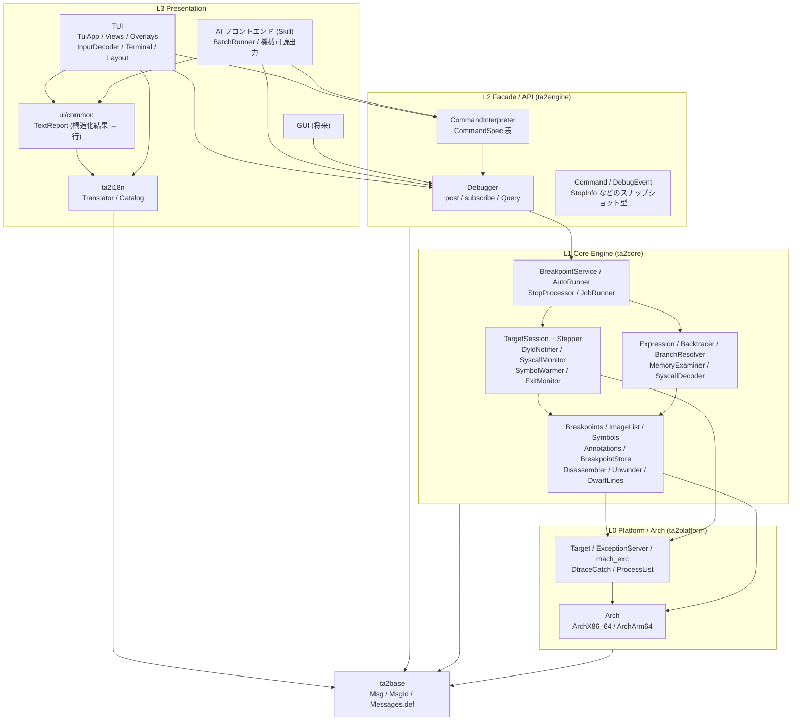
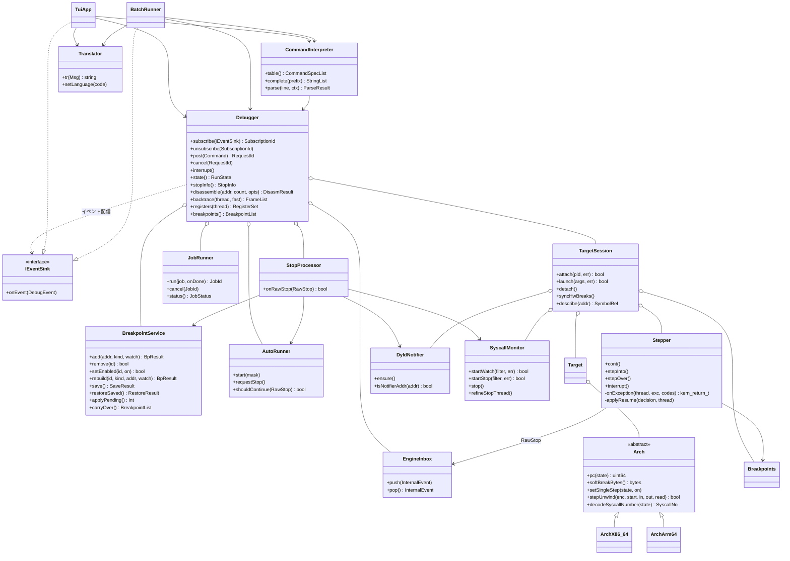
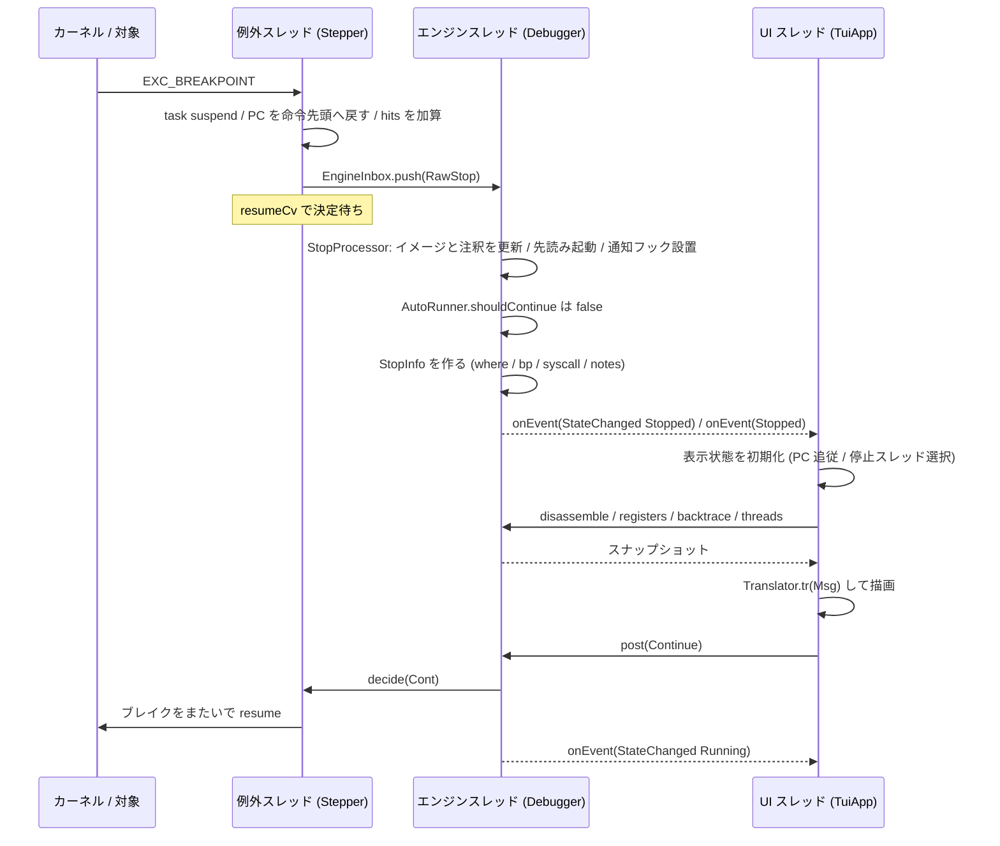
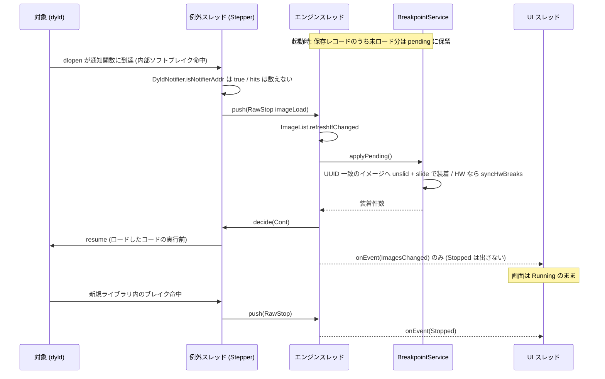
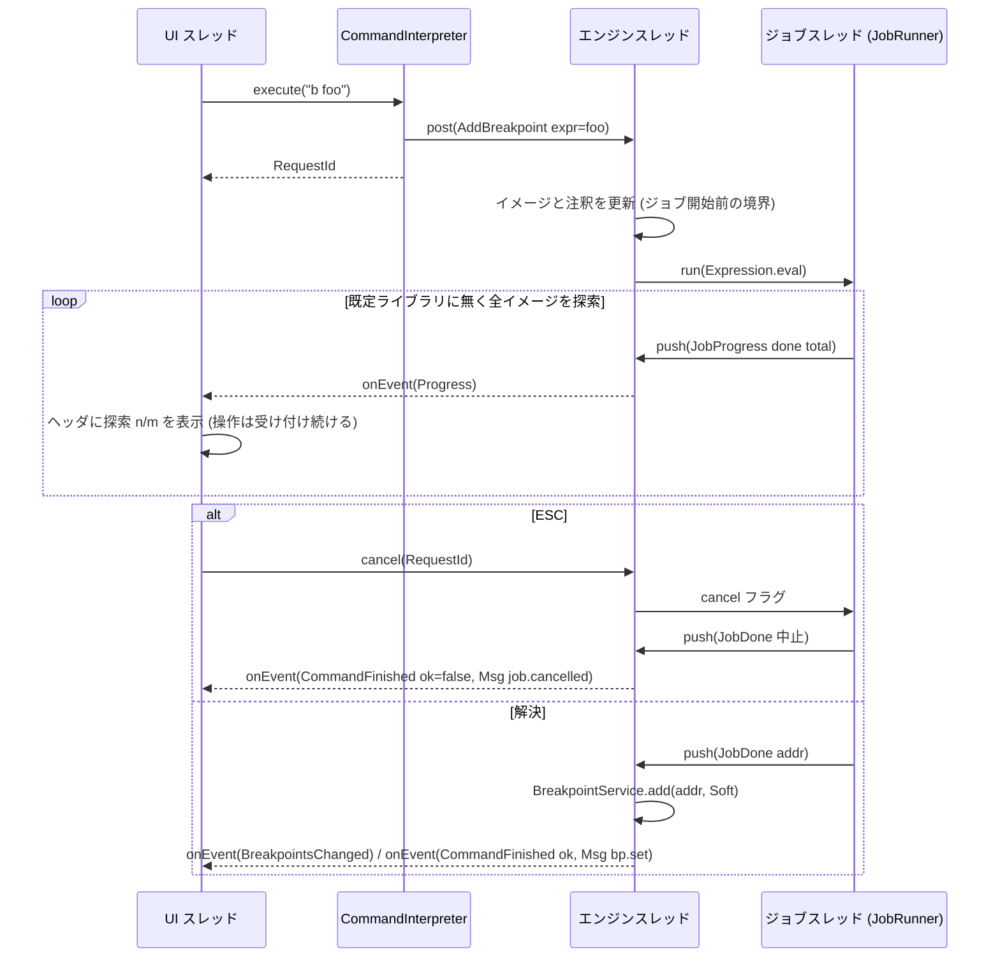
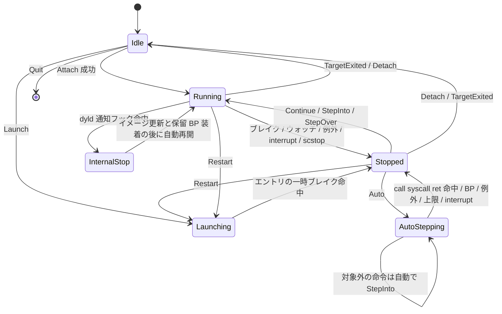
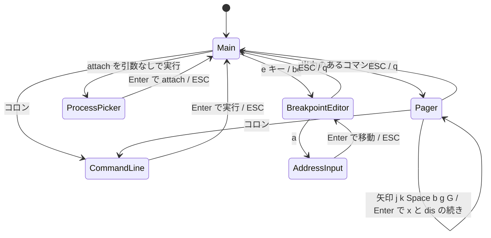
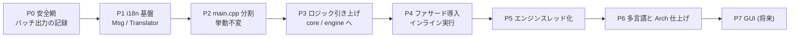

# ta2debug リファクタリング設計書

- 対象: `/Users/ta2/DEVELOP/OSX/ta2debug`（調査時点の HEAD: `7065102`）
- 位置づけ: 実装前の設計。本書は既存コードを一切変更しない。実装工程はこの文書の「段階的移行計画」に沿って進める。
- 既存の `DESIGN.md`（初版設計）を置き換えるものではなく、その後に膨らんだ実装を整理し直すための追補である。

## 1. 概要と目的

ta2debug は `task_for_pid` + Mach 例外ポートで対象を非ストップのまま扱う macOS ネイティブデバッガ（C++17）である。機能は揃っているが、次の 5 点を満たす構造にはなっていない。本設計はこれを満たす構成と移行手順を定める。

| # | 要件 | 設計上の答え（要約） |
|---|---|---|
| 1 | 機能を 100% 維持 | 全コマンド・全キー・全自動動作を §10 の機能パリティ表で新モジュールへ対応づける。既定言語は日本語のままなので表示文言も変わらない |
| 2 | x86_64 / arm64 両対応 | 既存 `Arch` 抽象を踏襲。抽象の外へ漏れている 4 箇所（§9.2）を `Arch` へ戻し、非ホスト側もコンパイル検査する |
| 3 | 表示内容の i18n | core は文字列を作らず `Msg`（メッセージ ID + 名前付き引数）を返す。翻訳は Presentation 層の `Translator` だけが行う（§8） |
| 4 | ロジックと UI の完全分離 | ヘッドレスなファサード `Debugger` を新設。TUI / GUI / AI は「コマンド投入 + イベント購読 + 読み取りクエリ」だけで駆動する（§6, §7） |
| 5 | AI エージェント（Skill）から使いやすい | バッチ正面を「AI フロントエンド」として一級扱いにする。ヘッドレスな `Debugger` を非対話で駆動し、自己記述的なコマンド目録（`CommandSpec` 由来）・安定した機械可読出力・MsgId ベースの安定したエラー識別子を提供する（§7.5）。GUI / TUI / AI の 3 つを対等なユースケースとして設計する |

**想定ユースケース（Presentation は 3 種類）。** いずれも同一のヘッドレス `Debugger` ファサードを使う。

- **TUI** … 端末上の対話 UI（現行）。
- **GUI** … 将来のネイティブ GUI。
- **AI** … AI エージェントが `ta2debug` スキル経由で非対話に駆動する（現行の `-b -o` バッチの発展）。人間の対話を介さず、出力を解析して次のコマンドを決める利用を一級要件とする。

前提として次を維持する（`DESIGN.md` の大前提と同じ）。

- 依存最小: capstone、libdtrace、CommonCrypto、Carbon（IME）、システムフレームワークのみ。i18n のために gettext / ICU などを足さない。
- ホスト PC のアーキ = ターゲットのアーキ。Rosetta 越しの x86_64 プロセスなど異アーキ対象は扱わない。
- 非ストップ型・sudo 前提・自作プログラム専用という性格は変えない。

## 2. 現状アーキテクチャ分析

### 2.1 規模と構成（実測）

| 場所 | 主なファイル | 行数 | 役割 |
|---|---|---|---|
| `src/app/main.cpp` | 1 ファイル | 2934 | TUI 本体、バッチ、コマンド解釈、ブレイク復元、auto、非同期ジョブ、バックトレース計算まで全部 |
| `src/app/Expression.cpp` | | 237 | 式評価（`Session` に依存） |
| `src/core/Session.cpp` | | 1193 | 例外処理・ステップ状態機械・dtrace・dyld 通知フック・syscall デコード表と整形 |
| `src/core/*`（その他） | Target, Breakpoints, Symbols, ImageList, Unwind, DwarfLines, Annotations, BreakpointStore, DtraceCatch, Disassembler, ProcessList, ExceptionServer | 約 2700 | デバッグ機構 |
| `src/core/arch/*` | ArchX86_64, ArchArm64 | 553 | アーキ依存 |
| `src/ui/*` | Terminal, Layout | 409 | 端末制御とレイアウト計算 |

### 2.2 現在のスレッド

| スレッド | 起点 | やっていること |
|---|---|---|
| メイン | `main()` のループ | `EventQueue::pop` → `onKey` / `onMouse` / `onStoppedEvent` / `render`。ロジックも描画も全部ここ |
| 入力 | `main()` 内のラムダ | stdin と SIGWINCH 用 self-pipe を `poll`。ESC 列（40ms 判定）と SGR マウスを組み立てて `Event` を積む |
| 例外サーバ | `ExceptionServer` | `mach_msg_server`。`Session::onException` 内で resume 決定（`resumeCv_`）を待ってブロックする |
| 終了監視 | `Session::startExitMonitor` | kqueue `NOTE_EXIT` → `Event::TargetExited` |
| シンボル先読み | `Session::warmSymbols` | 全イメージのシンボルを読み、80ms 間引きで `Event::Progress` |
| dtrace consumer | `DtraceCatch::loop` | `:scwatch` の集計 / トレース、`:scstop` の発火（`onSyscallStopHit`） |
| ジョブ | `evalAsync`（main.cpp） | 式評価（全イメージ横断のシンボル探索）。`g_jobCancel` で中止、`Event::JobDone` で結果適用 |

### 2.3 問題点

1. **main.cpp にロジックが溶け込んでいる。** 次はいずれも UI ではなくデバッガの振る舞いだが、`g_term` / `g_message` / `render()` と同じ関数内にある。
   - ブレイク永続化と復元: `saveBreakpoints` / `restoreBreakpoints` / `applyOneBp` / `applyPendingBreakpoints` / `g_pendingBp` / `g_restorePending`
   - 再起動時のブレイク引き継ぎ: `doRestart`
   - ブレイクの種別変換・移動: `bpAddKind` / `bpRebuild`（Soft⇄Hard、ウォッチのサイズ・アクセス変更）
   - dlopen 透過捕捉の後半: メインループの `stopIsImageLoad()` 分岐（イメージ更新 → 保留ブレイク装着 → 即 `cont`）
   - 停止後処理: `onStoppedEvent`（イメージ・注釈更新、発火スレッド確定、先読み起動、通知フック設置、auto 継続判定、停止メッセージ合成）
   - auto: `g_autoMask` / `g_autoSteps` / `kindAtPc` / `kAutoMax`
   - バックトレース: `computeBacktrace` とそのヒューリスティック（`addrIsCode` / `addrIsCallReturn` / `scanStackForReturn`）
   - 間接分岐の飛び先解決: `resolveIndirectTarget`
   - メモリ整形: `examineMemory` / `classicDump` / `formatValue`
   - 非同期式評価: `evalAsync` / `withBreakId` と `g_job*` 一式
2. **依存方向が逆転している。** `inc/core/Session.h` が `app/EventQueue.h` を include し、`Event` にはキー・マウス・リサイズという UI の語彙が入っている。core が UI のイベント型を知っている。`Expression` は core の部品を使う純ロジックなのに `app/` にある。
3. **状態が全部グローバル。** main.cpp に `g_` 変数が約 70 個あり、エンジン状態（`g_state`、`g_pendingBp`、`g_launchArgs`）と表示状態（`g_disasmTop`、`g_pickSel`）が区別なく並ぶ。
4. **バッチと TUI が `g_interactive` の分岐で同居。** バッチでは「式評価は同期」「シンボル先読み無効」「保存ブレイクの自動復元なし」「dyld 通知フックなし」という差があるが、これは `if (g_interactive)` が各所に散っているだけで、設定として表現されていない。
5. **表示文字列がハードコード。** コメントを除く非 ASCII 文字列リテラルは実測で約 550 個（main.cpp 459、Expression.cpp 36、DtraceCatch.cpp 14、Annotations.cpp 13、Session.cpp 10、BreakpointStore.cpp 8、Target.cpp 6、Layout.cpp 6 ほか）。core 層が日本語文を直接組み立てて `std::string& err` や `stopReason()` で返している。
6. **結果の受け渡しが文字列。** コマンド結果は `g_message`（1 行）と `g_output`（ANSI 入りの行配列）で、バッチは `stripAnsi` で色を剥がして再利用している。GUI が欲しい構造化データ（アドレス、シンボル、件数）は文字列に焼かれた後で失われている。
7. **コマンド表が二重。** `runCommand` の `if (cmd == ...)` 連鎖、`completeCommand` の `CMDS[]`、`:help` の `H[]`、`printUsage` が別々に手書きされ、同期していない（例: `disas` / `disassemble` / `att` / `launch` の別名は補完表やヘルプに無い）。
8. **Arch 抽象の外への漏れ**（§9.2 に列挙）。
9. **UI スレッドで重い処理が走る。** `render()` のたびにメモリ読取・逆アセンブル・シンボル解決・バックトレースを実行する。式評価だけは非同期化済みだが、「UI を決して固めない」を構造として保証していない。



### 2.4 現状で良い点（維持するもの）

- `Arch` 抽象は十分に機能している。`Target` / `Breakpoints` / `Unwinder` / `Disassembler` はアーキ非依存に書けている。
- 例外スレッドが resume 決定を待つ方式、Ctrl+C / dtrace `stop()` の「手動停止」経路（`manualStop_` → `resumeManual`）、SW/HW ブレイクをまたぐ `uncoverBreakAtPc` の統一手順は正しく動いており、ロジックは変えずに置き場所だけ移す。
- `.t2a` / `.t2b` はイメージ UUID + unslid アドレスで保存しており、ASLR と再実行に強い。形式は変えない。
- イベントをメインスレッド 1 本に直列化する考え方は正しい。直列化する場所を「UI スレッド」から「エンジンスレッド」へ移すだけである。

## 3. 目標アーキテクチャ

### 3.1 レイヤリング

依存は上から下への一方向のみ。CMake のライブラリ分割でこれを強制する（下位ライブラリは上位のヘッダを include できない）。

| 層 | ライブラリ | 内容 | 知ってはいけないもの |
|---|---|---|---|
| L3 Presentation | `ta2tui`（TUI）/ `ta2ai`（AI フロントエンド＝バッチ発展、Skill が使う）/（将来）GUI | 画面、入力、ページャ、ピッカー、機械可読出力、翻訳 | Mach API、`Target`、`Session` の内部 |
| L2 Facade / API | `ta2engine` | `Debugger`、`Command`、`DebugEvent`、スナップショット型、`CommandInterpreter` | 端末、ANSI、言語カタログ |
| L1 Core Engine | `ta2core` | ステップ状態機械、ブレイク、シンボル、アンワインド、式、syscall デコード、永続化 | UI、イベントループ、表示言語 |
| L0 Platform / Arch | `ta2platform` | `Arch`、`Target`、`ExceptionServer`、MIG、`DtraceCatch`、`ProcessList` | L1 以上すべて |
| 横断 | `ta2base` | `Msg` / `MsgId`（`Messages.def`）。全層が使う値型 | 何も知らない |
| 横断 | `ta2i18n` | `Catalog` / `Translator`。L3 だけがリンクする | core、engine |



### 3.2 ディレクトリ案

`inc/` と `src/` の両方に同じ構成を置く（現行の流儀を踏襲）。

| ディレクトリ | 入るもの | 由来 |
|---|---|---|
| `base/` | `Msg.h`、`Messages.def` | 新規 |
| `platform/` | `Arch.h`、`arch/ArchX86_64.cpp`、`arch/ArchArm64.cpp`、`Target`、`ExceptionServer`、`mach_exc*`、`DtraceCatch`、`ProcessList` | `core/` から移動 |
| `core/` | `Breakpoints`、`ImageList`、`Symbols`、`Annotations`、`BreakpointStore`、`Disassembler`、`Unwind`、`DwarfLines`、`Stepper`、`TargetSession`、`DyldNotifier`、`SyscallMonitor`、`SymbolWarmer`、`ExitMonitor`、`SyscallDecoder`、`SyscallTables`、`SyscallNames.inc`、`Expression`、`Backtracer`、`BranchResolver`、`MemoryExaminer` | 既存 + `Session.cpp` の分割 + main.cpp / `app/` からの引き上げ |
| `engine/` | `Debugger`、`Command.h`、`DebugEvent.h`、`Snapshots.h`、`EngineInbox`、`StopProcessor`、`BreakpointService`、`AutoRunner`、`JobRunner`、`CommandInterpreter`、`CommandSpec` | 新規（中身の大半は main.cpp からの引き上げ） |
| `i18n/` | `Catalog`、`Translator` | 新規 |
| `ui/common/` | `TextReport`（構造化結果を表示行へ。TUI のオーバレイとバッチ出力が共用） | main.cpp の `g_output` 生成部 |
| `ui/tui/` | `TuiApp`、`InputDecoder`、`UiQueue`、`Terminal`、`Layout`、`views/`（Disasm / Registers / Backtrace / Threads / Header / StatusLine）、`overlays/`（Pager / ProcessPicker / BreakpointEditor / CommandLine） | `ui/` + main.cpp |
| `ui/batch/` | `BatchRunner` | main.cpp のバッチ部 |
| `app/` | `main.cpp`（引数解析と front-end 選択だけ。100 行程度） | main.cpp |
| `res/i18n/` | `en.msg` など追加言語のカタログ | 新規 |

## 4. モジュール境界と責務

### 4.1 L0 Platform / Arch

| モジュール | 責務 | 変更点 |
|---|---|---|
| `Arch` | レジスタ、スレッド状態 flavor、ソフトブレイク命令、単一ステップ、HW ブレイク / ウォッチ、CFI 1 ステップ、syscall レジスタ、capstone 設定、命令分類 | §9 の強化（syscall クラス判定、PC 相対ベース名、ベクタレジスタ名、記法切替の可否を追加） |
| `Target` | attach / launch / detach、suspend 計上（外部 suspend の取り込み含む）、メモリ R/W、スレッド状態 | エラーを `std::string& err` から `Msg& err` へ |
| `ExceptionServer` | 例外ポート差し替え・復元、受信スレッド | 変更なし |
| `DtraceCatch` | libdtrace の観測 / トレース / `stop()` | エラーを `Msg` へ（`dtrace_errmsg` の文字列は引数として渡す） |
| `ProcessList` | プロセス列挙と attach 可否 | 変更なし |

### 4.2 L1 Core Engine

`Session`（1193 行）は責務ごとに分ける。分けるだけでアルゴリズムは変えない。

| 新モジュール | 由来 | 責務 |
|---|---|---|
| `Stepper` | `Session::onException` / `applyResume` / `decide` / `resumeManual` / `interrupt` / `setStep` / `detectWatchHit` と `singleStepping_` ほかの状態 | 「止まる / 続ける / ステップ」の状態機械。例外スレッドで動き、停止を `RawStop` としてエンジンの受信箱へ積んで resume 決定を待つ |
| `TargetSession` | `Session` の残り（attach / launch / detach、`findEntryPoint`、`syncHwBreaks`、`setRegister`、`describe`、`symbolName`、`sourceLineFor`、`defaultLib`） | 1 対象ぶんの部品の所有者。`Target` / `Breakpoints` / `ImageList` / `Symbols` / `Annotations` / `Stepper` を束ねる |
| `DyldNotifier` | `ensureDyldNotifier` / `dyldNotifyAddr_` / `stopIsImageLoad_` | dyld のイメージ通知関数へ内部ソフトブレイクを置き、命中を「内部停止」として識別する |
| `SyscallMonitor` | `startSyscallWatch` / `startSyscallStop` / `onSyscallStopHit` / `refineSyscallStopThread` / `firingThreadFor` と `sc*` 状態 | `:scwatch`（集計 / トレース）と `:scstop`（停止）の排他管理。発火スレッドの確定 |
| `SymbolWarmer` | `warmSymbols` / `stopSymbolWarming` と `warm*` | 全イメージのシンボル先読みと進捗 |
| `ExitMonitor` | `startExitMonitor` / `stopExitMonitor` | kqueue による終了検知 |
| `SyscallDecoder` + `SyscallTables` | `Session.cpp` の無名名前空間（`kScalls` / `kScallNames` / `kMachTraps` / `dec*` / `joinFlags`）と `syscallAtStop` | 停止位置の syscall / Mach トラップを構造化して返す（`SyscallCall`）。表は言語非依存データ |
| `Expression` | `app/Expression` | 式評価。`Session&` ではなく狭いインタフェース `EvalContext`（レジスタ読取、イメージ、シンボル、既定ライブラリ、キャンセル、進捗）に依存。エラーは `Msg` |
| `Backtracer` | main.cpp `computeBacktrace` ほか | CFI（compact unwind / DWARF）+ 入口・IP=0・スタブのヒューリスティック + スタック走査。結果は `Frame` の配列（色や文字列整形を含まない） |
| `BranchResolver` | main.cpp `resolveIndirectTarget` | 間接 call / jmp の飛び先をレジスタとメモリから解く |
| `MemoryExaminer` | main.cpp `examineMemory` / `classicDump` / `formatValue` / `parseHexBytes` | `x/NFS` の解釈と値の取り出し。結果は `ExamineResult`（行ごとのアドレス + 値 + 種別）。継続位置も返す |

既存の `Breakpoints` / `ImageList` / `Symbols` / `Annotations` / `BreakpointStore` / `Disassembler` / `Unwinder` / `DwarfLines` は API をほぼ保ち、エラーの型だけ `Msg` に変える。

### 4.3 L2 Facade / API

| モジュール | 由来 | 責務 |
|---|---|---|
| `Debugger` | 新規 | 唯一の公開窓口。コマンド受付、イベント配信、読み取りクエリ。エンジンスレッドを所有する |
| `EngineInbox` | `app/EventQueue` のうち `Stopped` / `TargetExited` / `Progress` / `JobDone` | 内部スレッド（例外・終了監視・先読み・dtrace・ジョブ）→ エンジンスレッドの受信箱。UI の語彙（Key / Mouse / Resize）は持たない |
| `StopProcessor` | main.cpp `onStoppedEvent` とメインループの `Stopped` 分岐 | 生の停止を受けて後処理し、公開イベント `Stopped{StopInfo}` を作る。内部停止（dlopen）は公開せずに処理して再開する |
| `BreakpointService` | main.cpp `bpAddKind` / `bpRebuild` / `toggleBreakAtCursor` の中核 / `saveBreakpoints` / `restoreBreakpoints` / `applyOneBp` / `applyPendingBreakpoints` / `doRestart` の引き継ぎ部 | ブレイクの追加・削除・有効無効・種別変換・移動・ウォッチ条件変更（失敗時の巻き戻し込み）、HW 同期、永続化、復元、保留（dlopen 待ち）管理 |
| `AutoRunner` | main.cpp `g_autoMask` / `g_autoSteps` / `kindAtPc` / `kAutoMax` | auto の継続判定（call / syscall / ret、ブレイク命中、例外、200 万命令上限、中断要求） |
| `JobRunner` | main.cpp `evalAsync` / `g_job*` | キャンセル可能・進捗つきの非同期ジョブ。同時に 1 本。走行中は他の状態変更コマンドを受けない（現行の `g_jobRunning` ガードと同じ規則） |
| `CommandInterpreter` + `CommandSpec` | main.cpp `runCommand` / `completeCommand` / `withBreakId` / バッチ専用コマンドの解釈 | テキスト 1 行 → `Command`（エンジン向け）または `UiAction`（表示側だけで完結する要求）へ変換。コマンド表は補完・ヘルプ・使用法の唯一の出所 |

### 4.4 L3 Presentation

| モジュール | 由来 | 責務 |
|---|---|---|
| `TuiApp` | main.cpp のメインループ、`onKey`、`onMouse`、`render` | UI スレッドのイベントループ。モード（§7.4）に応じて入力を配り、ビューを描く |
| `UiQueue` | `EventQueue` のうち Key / Mouse / Resize + エンジンイベントの受け口 | UI スレッドの受信箱。`IEventSink` 実装がエンジンイベントをここへ積む |
| `InputDecoder` | `main()` の入力スレッドのラムダ | ESC 列の 40ms 判定、矢印の合成コード化、SGR 1006 マウス、SIGWINCH self-pipe |
| `views/*` | `drawDisassembly` / `drawRegisters` / `drawBacktrace` / `drawThreads` / ヘッダ行 / 最下行 | スナップショットを受け取って描くだけ。対象メモリへは触らない |
| `overlays/Pager` | `g_output*` / `g_x*` とオーバレイのキー処理 | 出力のページング、`x` / `dis` の Enter 継続 |
| `overlays/ProcessPicker` | `openPicker` 〜 `handlePickerKey` | 絞り込み、縦横スクロール、選択 |
| `overlays/BreakpointEditor` | `openBpEditor` 〜 `handleBpEditorKey` | 一覧と操作キー。実操作は `Debugger` へ `Command` を投げる |
| `overlays/CommandLine` | `g_cmdMode` / `g_cmdline` / `renderCmdline` | 入力行、TAB 補完（候補は `CommandInterpreter` から）、最下行だけの部分再描画 |
| `Terminal` / `Layout` | 現行のまま | raw / ANSI / マウス / セル格子 / 選択コピー / IME 半角化、ペイン計算と表示幅。レイアウト名だけ `Msg` 化 |
| `TextReport` | 各コマンドの `g_output.push_back(...)` | 構造化結果 + `Translator` → スタイル付き行。TUI は ANSI に、バッチは素のテキストにする（`stripAnsi` は不要になる） |
| `BatchRunner`（= AI フロントエンド） | `runBatch` / `batchExec` / `batchStopReport` / `batchWaitForStop` / `disToOutput` | `-b -o -s` と標準入力。`Debugger` のイベントを同期的に待つ薄いフロントエンド。AI エージェント（`ta2debug` スキル）が駆動する正面。安定した機械可読出力と自己記述的コマンド目録を提供する（§7.5） |

## 5. クラス構成



## 6. ヘッドレス API 定義

名前空間は `ta2::engine`。以下は擬似シグネチャで、型名は実装時に微調整してよいが、形（コマンドは非同期投入、結果はイベント、参照は同期クエリ）は固定する。

### 6.1 ファサード

```cpp
enum class RunState { Idle, Running, Stopped };
using RequestId = uint64_t;
using ThreadId  = uint32_t;            // thread_act_t を UI に見せるための別名。0 = 停止スレッド

struct EngineOptions {                 // 現行の g_interactive 分岐を設定として表す
  bool warmSymbols            = true;  // バッチは false（Session::setWarmingEnabled(false) 相当）
  bool dyldNotifier           = true;  // バッチは false（現行は TUI のみ ensureDyldNotifier）
  bool autoRestoreBreakpoints = true;  // バッチは false（現行は g_restorePending が TUI のみ）
};

class IEventSink {                     // エンジンスレッドから呼ばれる。積むだけですぐ戻ること
public:
  virtual ~IEventSink() = default;
  virtual void onEvent(const DebugEvent& ev) = 0;
};

class Debugger {
public:
  explicit Debugger(EngineOptions opts = {});
  ~Debugger();                         // detach してから内部スレッドを止める

  // ---- イベント購読 ----
  SubscriptionId subscribe(IEventSink* sink);
  void unsubscribe(SubscriptionId id);

  // ---- コマンド（非同期。結果は CommandFinished{RequestId, ...} で届く）----
  RequestId post(Command cmd);
  void cancel(RequestId id);           // 走行中ジョブ（シンボル探索）を中止。現行の ESC
  void interrupt();                    // 現行の Ctrl+C。auto 中なら auto 中断、Running なら停止、Stopped なら無視

  // ---- クエリ（同期・読み取り専用・どのスレッドからでも可）----
  RunState state() const;
  pid_t pid() const;
  ArchInfo arch() const;               // 名前、レジスタ名一覧、HW 本数、記法切替の可否など
  StopInfo stopInfo() const;           // 直近の停止（Stopped 以外では空）
  std::vector<ThreadInfo> threads() const;
  RegisterSet registers(ThreadId t = 0) const;
  std::vector<VecRegValue> vectorRegisters(ThreadId t = 0) const;
  std::vector<RegValue> debugRegisters(ThreadId t = 0) const;
  DisasmResult disassemble(uint64_t addr, int count, DisasmOptions o, ThreadId t = 0) const;
  uint64_t disasmBack(uint64_t addr, int insns) const;       // 上スクロール用（現行 disasmBack / prevInsnAddr）
  std::vector<Frame> backtrace(ThreadId t = 0, bool fast = false) const;
  MemoryBlock readMemory(uint64_t addr, size_t len) const;   // ブレイク命令は元バイトで見せる
  ExamineResult examine(const ExamineSpec& spec, uint64_t addr) const;
  SymbolRef describe(uint64_t addr) const;                   // image / symbol / offset
  bool sourceLine(uint64_t addr, SourceLoc& out) const;
  std::vector<BreakpointInfo> breakpoints() const;
  PendingInfo pendingBreakpoints() const;                    // dlopen 待ちの件数
  std::vector<ImageInfo> images() const;
  std::vector<Segment> segments(const std::string& image) const;
  SymbolPage symbols(const std::string& image, const std::string& filter, size_t limit) const;
  std::vector<Annot> annotations(const std::string& image, std::string* path = nullptr) const;
  SyscallWatchStatus syscallWatch() const;                   // 稼働 / フィルタ / 件数 / 集計 or トレース行
  JobStatus job() const;                                     // 探索の done / total
  WarmStatus symbolWarming() const;
  static std::vector<ProcessInfo> processes();               // ピッカー用
  static SyscallNameList syscallNames(const std::string& filter, Msg& err);
};
```

### 6.2 コマンド

`Command` は構造体の `std::variant`。アドレスを取るものは数値でも式でも渡せる（式ならエンジン側で評価する。重い探索になればジョブ扱いになり、進捗イベントが出て中止できる）。

```cpp
struct AddrSpec { std::variant<uint64_t, std::string /*式*/> v; };
enum class BpKind { Soft, HwExec, Watch };
struct WatchParams { int size = 8; bool onRead = false; bool onWrite = true; };
struct BpRef { std::variant<int /*#id*/, AddrSpec> v; };

namespace cmd {
  struct Attach   { pid_t pid; };
  struct Launch   { std::vector<std::string> args; };
  struct Restart  {};                              // 同じ引数で起動し直し、ブレイクを引き継ぐ
  struct Detach   {};
  struct Continue {};  struct StepInto {};  struct StepOver {};
  struct Auto     { unsigned mask; };              // 1=call 2=syscall 4=ret
  struct AddBreakpoint      { AddrSpec at; BpKind kind; WatchParams watch; };
  struct RemoveBreakpoint   { BpRef ref; };
  struct ToggleEnabled      { BpRef ref; };
  struct ToggleBreakpointAt { uint64_t addr; };    // b キー / クリック。あれば解除、無ければソフトで設定
  struct RebuildBreakpoint  { int id; BpKind kind; uint64_t addr; WatchParams watch; }; // 失敗時は元に戻す
  struct SaveBreakpoints    {};
  struct SetRegister  { std::string name; AddrSpec value; };
  struct WriteMemory  { AddrSpec at; std::vector<uint8_t> bytes; };
  struct FillMemory   { AddrSpec at; uint8_t value; uint64_t size; };
  struct DumpToFile   { AddrSpec at; uint64_t size; std::string path; };
  struct LoadFromFile { AddrSpec at; uint64_t size; std::string path; };
  struct SetAnnotation    { AddrSpec at; std::optional<std::string> name, memo; };
  struct RemoveAnnotation { AddrSpec at; };
  struct SetDefaultLib    { std::string name; };   // 空で解除
  struct SyscallWatch     { std::string filter; }; // "off" 相当は SyscallOff
  struct SyscallStop      { std::string filter; };
  struct SyscallOff       {};
  struct Evaluate         { std::string expr; };   // :p / :sym / :dis の移動先 / :x の開始アドレス
  struct SetDisasmSyntax  { bool intel; };
}
using Command = std::variant<cmd::Attach, cmd::Launch, /* ... 上の全部 ... */ cmd::SetDisasmSyntax>;
```

### 6.3 スナップショット型（抜粋）

表示言語に依存する文字列は含めない。シンボル名、レジスタ名、syscall 名、`EXC_*` などの識別子はそのまま持つ。

```cpp
enum class StopKind { Entry, Breakpoint, Watchpoint, Step, Interrupt, Exception, SyscallCatch, Auto, Unknown };
enum class AutoStop { None, Call, Syscall, Return, Limit, Interrupted };

struct StopInfo {
  StopKind kind;  uint64_t pc;  ThreadId thread;
  SymbolRef where;                         // describe(pc) 相当
  int bpId = -1;  uint64_t bpHits = 0;  bool bpHw = false;
  int watchId = -1;  uint64_t watchAddr = 0;  uint64_t watchHits = 0;
  int exception = 0;  int64_t code0 = 0;  uint64_t faultAddr = 0;   // EXC_* と code
  std::string syscallCaught;               // :scstop で捕捉した名前
  std::optional<SyscallCall> syscall;      // PC が syscall / svc のときの呼び出し内容
  AutoStop autoStop = AutoStop::None;  long autoSteps = 0;
  std::vector<Msg> notes;                  // 復元件数など（現行は "／" 連結で g_message に足している）
};

struct DisasmLine {
  uint64_t addr;  std::string mnemonic, opStr;  InsnKind kind;
  bool isPc;  BpMark bp;                    // None / Soft / Hw / Watch と enabled
  std::optional<std::string> funcHeader;    // 関数先頭なら名前
  std::optional<SourceLoc> source;          // DWARF 行が変わる位置
  std::optional<BranchTarget> target;       // 直値 / 間接解決の飛び先とシンボル、スタブ先
  std::string memo;                         // ユーザ注釈のメモ
};

struct Frame { int index; uint64_t pc; SymbolRef sym; FrameOrigin origin; };  // CFI / FP / Entry / StackScan
struct SyscallCall { bool mach; uint64_t number; std::string name; std::vector<SyscallArg> args; std::string text; };
struct CommandResult {
  bool ok;  Msg message;                    // 現行の g_message に相当（空可）
  std::optional<uint64_t> value;            // 評価結果・設定したアドレスなど
  std::optional<int> breakpointId;
  ResultPayload payload;                    // ExamineResult / SymbolPage など（あれば）
};
```

### 6.4 CommandInterpreter

```cpp
struct CommandSpec {
  const char* name;                      // "b"
  std::vector<const char*> aliases;      // {"bedit"} など
  CommandGroup group;                    // ヘルプの見出し
  MsgId usage, help;                     // 使い方 1 行、ヘルプ本文
  unsigned flags;                        // NeedsAttach / NeedsStopped / BatchOnly / UiOnly / TakesArg
};

struct UiAction {                        // 表示側だけで完結する要求（エンジンは関与しない）
  enum Kind { OpenProcessPicker, OpenBreakpointEditor, ShowHelp, ShowOutput, GotoDisasm, FollowPc,
              SetMouse, ToggleMouse, SetBaseRelative, WaitForStop, PrintBacktrace, PrintDisasm, Quit } kind;
  /* 付随データ */
};

class CommandInterpreter {
public:
  explicit CommandInterpreter(Debugger& dbg);
  static const std::vector<CommandSpec>& table();
  std::vector<std::string> complete(const std::string& prefix) const;
  // 1 行を解釈。エンジン向けは post して RequestId を、表示向けは UiAction を、誤りは Msg を返す。
  ParseResult execute(const std::string& line, FrontEndKind fe);
};
```

`:be`、`:mouse`、`:baseoff`、`:help`、引数なしの `:attach`（ピッカー）、TUI の `:dis`（ペイン移動）は `UiAction` になる。`:dis` はバッチでは `PrintDisasm`（テキスト出力）になる。この差は現行どおりで、`FrontEndKind` で振り分ける。

## 7. イベント / コマンドモデル

### 7.1 イベント

現行の `Event` を 2 つに割る。

- **エンジン内部**（`EngineInbox`）: `RawStop` / `TargetExited` / `WarmProgress` / `JobProgress` / `JobDone` / `SyscallStopHit` / `CommandPosted`。内部スレッドが積み、エンジンスレッドだけが取り出す。
- **公開**（`DebugEvent`）: 下表。`IEventSink::onEvent` で届く。
- **UI 専用**（`UiQueue`）: `Key` / `Mouse` / `Resize` と、`IEventSink` が転記した `DebugEvent`。

| `DebugEvent` | 中身 | 現行の対応 |
|---|---|---|
| `StateChanged` | 新しい `RunState`、pid | `g_state = ...` の各所 |
| `Stopped` | `StopInfo` | `Event::Stopped` + `onStoppedEvent()` が true を返したとき |
| `TargetExited` | なし | `Event::TargetExited` |
| `BreakpointsChanged` | なし（一覧はクエリで取る） | 明示イベントなし（毎回 `render`） |
| `ImagesChanged` | 追加 / 削除の件数、今回装着できた保留ブレイク数 | dlopen 透過処理（現行は無言） |
| `Progress` | 種別（先読み / 探索）、done、total | `Event::Progress` |
| `CommandFinished` | `RequestId`、`CommandResult` | `Event::JobDone` + `g_jobApply`、および同期実行の直後 |
| `Notice` | `Msg` | エンジン起点の通知（例: auto 中断） |

配信規則:

- `onEvent` はエンジンスレッドから呼ぶ。購読側は自分のキューへ積んで戻るだけにする（TUI は `UiQueue::push`、GUI はメインスレッドへディスパッチ）。
- auto の途中経過や dlopen の内部停止は `Stopped` として公開しない。UI から見ると `Running` のままである（現行の「止まって見えない」を保つ）。
- `Progress` は現行と同じ 80ms 間引きを送信側で行う。

### 7.2 スレッド境界

| スレッド | 所有するもの | 触ってよいもの |
|---|---|---|
| UI（TUI のメイン） | 表示状態（カーソル、スクロール、モード、選択）、`Terminal` | `Debugger` の公開 API のみ |
| エンジン（新設、`Debugger` が所有） | 対象の論理状態（ブレイク一覧、保留、auto、`RunState`）、イメージ / 注釈の更新 | core の全部品 |
| 例外サーバ | `Stepper` の例外処理中の状態 | `Target` / `Breakpoints` の物理層。エンジンとは「停止を積む → resume 決定を待つ」で同期 |
| 終了監視 / 先読み / dtrace / ジョブ | それぞれの作業 | `EngineInbox::push` のみ（+ 各部品の既存 mutex 内の処理） |

同期の取り決め:

1. **状態変更は全部エンジンスレッド。** 現行で「メインスレッドの境界で行う」と決めている処理（`refreshImages`、`refreshAnnotations`、`refineSyscallStopThread`、ブレイク操作）をそのままエンジンスレッドへ移す。直列化の性質は変わらない。
2. **クエリは `std::shared_mutex`。** エンジンスレッドは状態を変える区間で排他ロック、クエリは共有ロックを取る。対象が走行中でも読める（非ストップ型なので `:x` や `:img` は Running でも有効。現行どおり）。
3. **重いものはジョブへ。** 全イメージ横断のシンボル探索は `JobRunner`。クエリが遅くなり得るもの（初回の `symbols()`、深い `backtrace()`）は UI 側がワーカから呼べるよう、クエリ API をスレッドセーフにしておく。TUI は当面 UI スレッドから直接呼び（現行と同じ負荷）、GUI や将来の TUI 改善でワーカ化できる。
4. **例外スレッドの待ち合わせは現行のまま。** `resumeCv_` で決定を待つ。手動停止（Ctrl+C、dtrace `stop()`、エントリ不明時の launch）は例外スレッドが待っていないので、エンジンスレッドが `applyResume` を実行する（現行 `resumeManual`）。
5. **終了順序。** `~Debugger` は「ジョブ中止 → dtrace 停止 → 先読み停止 → detach（例外スレッドへ `Resume::Detach` を渡して ack を待つ）→ エンジンスレッド join」。現行 `Session::detach` の順序を守る。

移行の途中段階として、エンジンスレッドを作らず UI スレッドが `Debugger::pump()` を呼んで受信箱を処理する「インライン実行」構成を許す（フェーズ 4）。API の形は同じなので、フェーズ 5 でスレッドを分けても Presentation 側は変わらない。バッチは最後までインライン実行でよい。

### 7.3 シーケンス

ブレイク命中から画面更新まで:



dlopen の透過捕捉と保留ブレイクの自動装着:



非同期シンボル探索（`:b <シンボル>`）:



### 7.4 状態

エンジンの実行状態（公開されるのは Idle / Running / Stopped の 3 つ。Launching / AutoStepping / InternalStop は UI からは Running に見える内部状態）:



TUI の入力モード（現行の `g_pickerMode` / `g_bpEditMode` / `!g_output.empty()` / `g_cmdMode` / `g_bpInput` の優先順をそのまま状態にしたもの）:



ジョブ走行中（探索の進捗表示中）はモードではなくフラグで、どのモードでも ESC が最優先で中止に割り当たる（現行 `onKey` 冒頭と同じ）。Main モードのキーは `RunState` が Stopped のときだけ有効なものが多い（§10）。

### 7.5 AI エージェント（Skill）からの利用（要件 5）

AI フロントエンド（`ta2ai` ＝ 現行 `-b -o` バッチの発展）は、人間の対話を介さず AI エージェントが `ta2debug` スキル経由で駆動する正面である。TUI / GUI と同じヘッドレス `Debugger` を使い、`CommandInterpreter` で 1 行コマンドを `Command` に変換して `post` → `DebugEvent` を同期的に待つだけの薄いアダプタにする。設計上、AI にとっての「使いやすさ」を次の性質で担保する。

- **非対話で完結。** 対話プロンプトやカーソル/ペインに依存しない。コマンド列（`-o "cmd"` 複数、またはスクリプト `-s`、標準入力）を与えれば、各コマンドの結果を決定的な順序で出力して終わる。確認待ちで止まらない。
- **安定した機械可読出力。** 出力は「構造を示す固定トークン（翻訳しない。`stopped @`、`backtrace:`、`src:`、`[bp #N, Mhit]` 等）＋本文」で構成する（§8.7）。既定ロケールは日本語のままなので、既存スクリプトと現行 `ta2debug` スキルの期待値は不変。将来、機械可読性をさらに上げる **任意の構造化出力モード（`DebugEvent` / スナップショットを 1 行 1 レコードの JSON で吐く）** を同じファサードの上に追加できる余地を残す（本設計の必須範囲外。追加時も TUI/GUI/エンジンは不変）。
- **自己記述的なコマンド目録。** コマンド表 `CommandSpec`（補完・ヘルプ・使用法の唯一の出所、§4.3）を機械可読に書き出せるようにし、スキルやエージェントがコマンド名・引数・用法を動的に把握できる（`--help` の素テキストに加え、目録そのものを取り出す口を用意）。4 重管理をやめた単一表なのでドリフトしない。
- **安定したエラー識別子。** エラーは MsgId（§8.2）で識別できる。表示文は i18n で変わり得るが、`err.expr.div_zero` のような **ID は言語やバージョンを跨いで安定**なので、エージェントは表示文の文字列一致ではなく ID で分岐できる（構造化出力モードでは ID を添える）。
- **終了コードと到達可否。** コマンド列の成否・対象の終了・アタッチ可否などは終了コードと明示トークンで判別できるようにする（現行バッチの挙動を踏襲しつつ整理）。
- **決定性。** 可変部（アドレス、pid、時刻）以外は実行ごとに同じ出力になる。スキル側はアドレス等を正規化して比較できる（§11 P0 の基準出力と同じ考え方）。

要するに、AI 向けの「正しさ」は engine の構造化イベント／スナップショットと安定 ID に由来し、`ta2ai` はそれをテキスト（または将来 JSON）へ写すだけにする。TUI が画面に、GUI がウィジェットに写すのと対等な、第 3 のレンダラと位置づける。

## 8. i18n 設計

### 8.1 方針

1. **core / engine は文を作らない。** 返すのは `Msg`（ID + 名前付き引数）。`std::string& err` は `Msg& err` に、`Session::stopReason()` のような整形関数は構造化データ（`StopInfo`）に置き換える。
2. **翻訳は Presentation だけ。** `Translator::tr(const Msg&)` を呼ぶのは TUI / バッチ / GUI。UI は `Msg` のまま保持し、描画のたびに翻訳する（言語を実行中に切り替えても即反映される）。
3. **既定は日本語、どのキーにも必ず日本語文がある。** 追加言語に抜けがあっても日本語へフォールバックするので、表示が欠けることはない。
4. **翻訳しないものを決める。** シンボル名、レジスタ名、syscall / Mach トラップ名、`O_RDONLY` などのフラグ名、`EXC_BAD_ACCESS` / `KERN_INVALID_ADDRESS` などの識別子、`strerror` / `mach_error_string` / `dtrace_errmsg` の返す文字列は対象外。後者 3 つは `{detail}` 引数としてそのまま差し込む。
5. **依存を足さない。** gettext / ICU は使わない。カタログは自前の行形式で、パーサは 100 行程度。

### 8.2 `Msg` と ID

```cpp
// inc/base/Msg.h
enum class MsgId : uint16_t {
#define TA2_MSG(id, key, ja) id,
#include "base/Messages.def"
#undef TA2_MSG
  Count_
};

struct MsgArg {
  std::string name;                                   // "addr" "n" "name" ...
  std::variant<int64_t, uint64_t, std::string, std::shared_ptr<Msg>> value;
  bool hex = false;                                   // uint64_t を 0x.. で出すか
};

struct Msg {
  MsgId id = MsgId::None;
  std::vector<MsgArg> args;
  bool empty() const { return id == MsgId::None; }
  static Msg of(MsgId id);
  Msg& hex(const char* name, uint64_t v);
  Msg& num(const char* name, int64_t v);
  Msg& str(const char* name, std::string v);
  Msg& sub(const char* name, Msg m);                  // 入れ子（式エラー + 文字位置など）
};
```

`Messages.def` が唯一の出所で、ID、キー、既定の日本語文を 1 行で定義する。ID は enum なので、存在しないメッセージを参照するとコンパイルエラーになる。

```cpp
// inc/base/Messages.def（抜粋。右端が既定の日本語文）
TA2_MSG(None,              "",                      "")
TA2_MSG(BpSet,             "bp.set",                "#{id} ブレイク設定 {addr}")
TA2_MSG(BpSetFailed,       "bp.set_failed",         "ブレイク設定失敗（メモリに書けない？）")
TA2_MSG(BpNoSuchAtAddr,    "bp.none_at_addr",       "そのアドレスにブレイクは無い")
TA2_MSG(BpSaved,           "bp.saved",              "ブレイク {n} 件を保存 → {path}  （次回 :run 時に自動復元）")
TA2_MSG(BpRestored,        "bp.restored",           "保存ブレイク {n} 件を復元")
TA2_MSG(BpPendingLeft,     "bp.pending_left",       "うち {n} 件は未ロード（dlopen 後に自動復元）")
TA2_MSG(ErrExpr,           "err.expr",              "式エラー: {detail}")
TA2_MSG(ErrExprAtPos,      "err.expr.at_pos",       "{detail} ({pos} 文字目)")
TA2_MSG(ErrExprDivZero,    "err.expr.div_zero",     "0 で割れない")
TA2_MSG(ErrExprSymMissing, "err.expr.sym_missing",  "シンボル '{name}' が見つからない（{where} ほか全イメージを探した。ライブラリ名!{name} も試せます）")
TA2_MSG(ErrTaskForPid,     "err.target.task_for_pid", "task_for_pid 失敗: {detail}（root 実行か、SIP 無効か、対象が自作バイナリかを確認）")
TA2_MSG(StopExcBadAccess,  "stop.exc.bad_access",   "EXC_BAD_ACCESS（不正メモリ参照）")
TA2_MSG(StopSyscallCatch,  "stop.syscall_catch",    "syscall キャッチ: {name}")
TA2_MSG(StopCrashHint,     "stop.crash_hint",       "⚠ {reason}  — c で対象を通常終了（シグナルを本来のハンドラへ通す）")
TA2_MSG(AutoStopped,       "auto.stopped",          "auto → {kind} で停止（{n} 命令）")
TA2_MSG(UiRunningHint,     "ui.running_hint",       "(実行中。ブレイクに当たると停止します。Ctrl+C で割り込み停止)")
TA2_MSG(LayoutStandard,    "layout.name.standard",  "標準")
TA2_MSG(HelpCmdB,          "help.cmd.b",            "ソフトブレイク（INT3/BRK）")
```

キー体系は `<領域>.<対象>[.<詳細>]`。

| 領域 | 用途 | 生成元の層 |
|---|---|---|
| `err.*` | 失敗理由（`err.expr.*` / `err.target.*` / `err.dtrace.*` / `err.ann.*` / `err.store.*`） | L0 / L1 |
| `stop.*` / `auto.*` | 停止理由、auto の停止種別 | L1 / L2 |
| `bp.*` / `ann.*` / `sc.*` / `mem.*` / `reg.*` / `tgt.*` / `job.*` | コマンド結果の通知 | L2 |
| `cmd.*` | 使い方（usage）、不明コマンド、補完候補 | L2（ID を返すだけ） |
| `help.*` | ヘルプ本文（`help.key.*` / `help.cmd.*` / `help.section.*` / `help.note.*`） | L3 |
| `ui.*` / `layout.*` / `picker.*` / `bpedit.*` / `pager.*` / `batch.*` | 画面の固定文言、ペイン見出し、フッタ | L3 |

### 8.3 カタログ

| 項目 | 設計 |
|---|---|
| 既定言語（日本語） | `Messages.def` の第 3 引数。バイナリに常に入る |
| 追加言語の置き場所 | リポジトリの `res/i18n/<lang>.msg`（例 `en.msg`）。ビルド時に CMake（`file(READ)` で文字列リテラル化）でバイナリへ埋め込む。sudo で動く単体バイナリなので、実行時にリソースファイルを探す必要を無くす |
| ユーザ上書き | `~/Library/Application Support/ta2debug/i18n/<lang>.msg`（注釈と同じ親ディレクトリ）。あれば埋め込みより優先。翻訳の試作や未収録言語の追加に使う。`TA2DEBUG_I18N_DIR` で場所を変えられる |
| 形式 | UTF-8 の行形式。`キー = 文`。`#` 始まりはコメント。`\n` `\t` `\\` と `{{` `}}` をエスケープとして解釈。`.t2a` / `.t2b` と同じく手編集できる |
| 解決順 | ユーザ上書き（選択言語）→ 埋め込み（選択言語）→ 既定の日本語 → キー文字列そのもの |
| ロード | `Translator` 生成時に 1 回。キー → `MsgId` の表を引いて `std::vector<std::string>`（`MsgId` 添字）に詰める。翻訳は添字参照 + 差し込みだけ |
| 検査 | セルフテスト `i18n_selftest` が、各 `.msg` のキーが `Messages.def` に存在すること、プレースホルダ名の集合が日本語文と一致すること、を検査する |

```
# res/i18n/en.msg
bp.set               = #{id} breakpoint set at {addr}
bp.set_failed        = failed to set breakpoint (memory not writable?)
bp.saved             = saved {n} breakpoint(s) -> {path}  (auto-restored on next :run)
err.expr             = expression error: {detail}
err.expr.at_pos      = {detail} (at column {pos})
err.expr.div_zero    = division by zero
stop.exc.bad_access  = EXC_BAD_ACCESS (invalid memory access)
auto.stopped         = auto -> stopped at {kind} ({n} instructions)
layout.name.standard = standard
```

### 8.4 パラメータ差し込み

- プレースホルダは名前付き `{name}`。語順が言語で変わっても翻訳側で並べ替えられる。
- 値の基本の出し方は引数の型で決まる: `hex` 付き `uint64_t` は `0x%llx`、整数は 10 進、文字列はそのまま、入れ子 `Msg` は再帰的に翻訳。
- 書式指定は必要なものだけ: `{addr:016x}`（ゼロ詰め 16 進）、`{n:d}`、`{name:q}`（引用符で囲む）。
- 複数形は日本語に無いので必須にしない。英語は `(s)` 表記で足りる。必要になれば `{n:plural(one,other)}` を後から足せる構文にしておく。
- カタログに無い名前のプレースホルダはそのまま残し、セルフテストで検出する。
- 桁揃えは翻訳後の文字列に対して `layout::displayWidth` / `fitWidth` で行う（全角 2 桁の扱いは既にある）。`printf("%-9s")` のようなバイト数基準の詰めは使わない。

現行の合成の置き換え例:

| 現行（main.cpp / core） | 新設計 |
|---|---|
| `snprintf(buf, "#%d ブレイク設定 0x%llx", id, addr); g_message = buf + "  " + describe(addr)` | エンジン: `Msg::of(BpSet).num("id", id).hex("addr", addr)` と `SymbolRef` を `CommandResult` で返す。UI: `tr(msg)` の後ろにシンボル表記を付ける |
| `g_message = "式エラー: " + eerr`（`eerr` は `"0 で割れない (5 文字目)"`） | `Msg::of(ErrExpr).sub("detail", Msg::of(ErrExprAtPos).sub("detail", Msg::of(ErrExprDivZero)).num("pos", 5))` |
| `Session::stopReason()` が `"EXC_BAD_ACCESS（不正メモリ参照） [KERN_INVALID_ADDRESS] @0x.."` を返す | `StopInfo{kind=Exception, exception=EXC_BAD_ACCESS, code0, faultAddr}`。UI 側の `StopFormatter` が `stop.exc.bad_access` と識別子・アドレスを組み立てる |
| `onStoppedEvent` が `" ／ "` で復元件数を連結 | `StopInfo::notes` に `Msg` を並べ、UI が区切り文字（`ui.note_sep`）で連結 |
| `err = std::string("dtrace_open 失敗: ") + dtrace_errmsg(...)` | `Msg::of(ErrDtraceOpen).str("detail", dtrace_errmsg(...))` |

### 8.5 表データの扱い

| データ | 現在地 | 方針 |
|---|---|---|
| BSD syscall 表 `kScalls`（番号 → 名前 + 引数シグネチャ）、`SyscallNames.inc`（SDK 全 `SYS_*`） | `Session.cpp` | 言語非依存。`core/SyscallTables` へ移すだけ。翻訳しない |
| Mach トラップ表 `kMachTraps` | 同上 | 同上 |
| フラグ表（`decOpenFlags` / `decProt` / `decMapFlags` / `decMachOption` / `decMsghBits` ほか） | 同上 | 定数名は翻訳しない。`SyscallDecoder` 内に残す |
| syscall 呼び出しの整形（`write(1, 0x.., 14) "hi"`） | `Session::syscallAtStop` | C 風の表記で言語非依存。`SyscallCall::text` として core が作ってよい。前置きの「→ syscall: 」だけが `Msg` |
| 例外名の説明（不正メモリ参照 など） | `Session::stopReason` | `stop.exc.*` |
| レイアウト名 5 種 | `Layout.cpp` の `name()` | `layout.name.*`。`Layout` は `MsgId` を返す |
| ヘルプ本文 | main.cpp `H[]` | コマンド行は `CommandSpec` の `usage` / `help` から生成。キー操作と注記は `help.key.*` / `help.note.*`。見出しの色付けは UI が付ける（カタログに ANSI を入れない） |
| バッチの使用法 `printUsage` | main.cpp | `batch.usage.*` |
| ブレイク印（● ◆ ○ ◇ ★ 👁 ▸ ⚠ ⏳ 🔍） | main.cpp | 記号は UI の定数で、翻訳対象外 |

### 8.6 ロケール選択

**システム自体の言語設定（環境変数）をそのまま使う。** 専用のコマンドやアプリ固有のオプション／環境変数は設けない。

優先順（最初に決まったものを使う）:

1. 環境変数 `LC_ALL` → `LC_MESSAGES` → `LANG` の言語部（`ja_JP.UTF-8` → `ja`）
2. 既定 `ja`

ロケールは**起動時に一度だけ**上記から決める（実行中の切り替えコマンドは設けない）。`Translator` が `Msg` を保持する構造自体は言語差し替えに耐えるが、本設計では切り替え口を公開しない。

補足:

- sudo は既定で環境変数を落とす（env_reset）ため、`LANG` 等が対象プロセスに届かないと既定の日本語になる。意図した言語にするには **`sudo -E`** か sudoers の `env_keep += "LANG LC_ALL LC_MESSAGES"` でシステムのロケールを引き継がせる（README に明記）。アプリ側に上書き手段は持たせない。
- 対応カタログが無い言語なら日本語で動き、起動時に 1 行だけ通知する。

### 8.7 バッチ出力の互換

バッチ出力は AI やスクリプトが解析する。構造を示す固定トークン（`ta2> `、`stopped @ `、`backtrace:`、`src: `、`[bp #N, Mhit]`、`[watch #N, ...]`）は現在も英語で、翻訳対象にしない。それ以外の本文はロケールに従う。既定が日本語のままなので、既存スクリプトと `ta2debug` スキルの期待値は変わらない。言語を固定したいスクリプトは、呼び出し側でシステムの環境変数（例 `LANG=ja_JP.UTF-8`、sudo 越しなら `sudo -E` 等）を整える。

### 8.8 移行の段階案

| 段階 | 作業 | 完了条件 |
|---|---|---|
| i-1 | `ta2base`（`Msg` / `Messages.def`）と `ta2i18n`（`Translator` / `Catalog`）を追加。既存コードは未変更 | `i18n_selftest` が通る |
| i-2 | main.cpp の `g_message = "..."` を `setMessage(Msg)` に機械的に置換。`g_message` の型を `Msg` へ。固定文言（ヘッダ、ペイン見出し、フッタ、ヒント）を `tr()` へ | 日本語表示がバイト単位で従来と一致（バッチ出力の差分ゼロ） |
| i-3 | core のエラーを `Msg& err` へ（`Target` → `DtraceCatch` → `Annotations` → `BreakpointStore` → `Expression` の順。呼び出し側は `tr(err)` を挟むだけ） | 同上 |
| i-4 | `stopReason` / `syscallAtStop` の前置き / auto 停止文を `StopInfo` + UI 側フォーマッタへ | 同上 |
| i-5 | `:help` / 補完 / `printUsage` を `CommandSpec` 生成へ | ヘルプ内容の差分を目視確認（行の並びは維持） |
| i-6 | `res/i18n/en.msg` を作成（ロケールは §8.6 のとおり環境変数から決定。切替コマンド/独自オプションは追加しない） | 英語ロケールで全画面・全コマンドを一巡。未訳キーゼロ |

i-2 から i-4 は §11 のフェーズ 1 と 3 に織り込む。

## 9. Arch 移植方針

### 9.1 基本方針

- 既存の `Arch` 抽象（`inc/core/Arch.h`、純粋仮想 + ホスト用ファクトリ `createForHost()`）を踏襲する。アーキ依存コードは `platform/arch/` の 2 ファイルにだけ置く。
- ビルドはホストアーキの実装だけがシンボルを出す現行方式（各ファイルを自アーキの `#if` で囲み、非ホスト側は空の翻訳単位）を維持する。
- ホスト = ターゲットを前提にする。`Target::attach` / `launch` で対象の cpu type を確認し、ホストと違えば `err.target.arch_mismatch` で拒否する（現行は無検査で `createForHost()` を使っており、Rosetta 下の x86_64 プロセスを掴むと誤動作し得る）。
- `Arch` より上の層（L1 以上）では `__x86_64__` / `__arm64__` の `#if`、レジスタ名の文字列比較、命令バイトの直書きを禁止する。レビュー項目とし、`grep` で検査する。

### 9.2 現状の漏れと対処

調査で見つかった、アーキ非依存であるべきコードに入り込んでいるアーキ知識は次の 4 箇所。

| 場所 | 内容 | 対処 |
|---|---|---|
| `Session::syscallAtStop`（Session.cpp） | syscall 番号レジスタの解釈。x86 は上位バイトのクラス（1=Mach, 2=Unix）、arm64 は負値なら Mach、という判定を 1 つの if 連鎖に混在させている | `Arch::decodeSyscallNumber(const void* state)` → `{bool mach; uint64_t number;}` を追加し、各実装に分ける |
| main.cpp `resolveIndirectTarget` | `in.baseReg == "rip" \|\| in.baseReg == "pc"` で PC 相対を判定 | `Insn` に `pcRelative` フラグを足し、`Disassembler` が capstone のレジスタ ID と `Arch::isPcRegister()` で立てる |
| main.cpp `:reg` の解釈 | `xmm` / `xmmN` / `v` / `vN` / `vec` / `fp` をハードコードで判定 | `Arch::vectorRegisterFamily()`（`"xmm"` / `"v"`）と本数を返す。総称 `vec` / `fp` / `fpregs` は共通別名として `CommandInterpreter` に残す |
| `Disassembler::setIntelSyntax` | x86 だけ有効な静的フラグ。arm64 では無視されるが UI は `:intel` を受け付けて成功メッセージを出す | `Arch::supportsSyntaxSwitch()` を追加。false なら `:intel` / `:atandt` は「このアーキでは無効」を返す。フラグは静的変数をやめ `Debugger` の設定にする |

### 9.3 強化項目

| 項目 | 内容 |
|---|---|
| `ArchInfo` | `Debugger::arch()` が返す表示用の記述（名前、汎用レジスタ名の並び、フラグレジスタ名、ベクタレジスタ族、HW 実行 / ウォッチ本数、共有プールか、記法切替の可否）。UI とヘルプはこれを見て分岐し、アーキ名を直接比較しない |
| ヘルプの出し分け | `:reg xmm[N] / vN`、`:dr` の説明は両アーキを併記した 1 文になっている。`ArchInfo` から該当アーキの文だけ出すか、併記のままにするかは翻訳キーの分割で選べるようにする |
| コンパイル検査の拡大 | 現行 CMake は `ArchArm64.cpp` だけを `-arch arm64` でコンパイル検査している。これを `ta2platform` と `ta2core` の全ソースへ広げる（リンクなし）。arm64 ホストでは逆に `-arch x86_64` を検査する |
| セルフテスト | `arch_selftest` に `decodeSyscallNumber`、`isPcRegister`、`vectorRegisterFamily` の検査を追加。テスト内の `cpuType() == CPU_TYPE_X86_64` 分岐は `ArchInfo` 参照に置き換える |
| 実機確認 | `ARM64_TESTING.md` の手順を、フェーズ 3 と 5 の完了条件に入れる（ステップ、SW/HW ブレイクのまたぎ、ウォッチの 1 命令またぎ、バックトレース、syscall デコード、`:scstop`） |
| 既知の差の保持 | arm64 固有の扱い（`hwWatchStopsBeforeAccess` による 1 命令またぎ、SS を HW 書き戻しより先に落とす順序、`softBreakPcBackup` = 0、戻りアドレスが LR）は `Stepper` / `Backtracer` へ移す際にコメントごと保つ |

## 10. 機能パリティ表

「現状」は調査時点の実装箇所、「エンジン」は L0〜L2 の担当、「表示」は L3 の担当。全行が新構成に載ることをもって要件 1 を満たす。

### 10.1 起動とフロントエンド

| 機能 | 現状 | エンジン | 表示 |
|---|---|---|---|
| `ta2debug [pid]` / `[パス 引数...]` で TUI 起動（全数字なら attach、他は起動） | `main()` | `cmd::Attach` / `cmd::Launch` | `app/main.cpp` → `TuiApp` |
| `-b` / `-o <cmd>`（複数）/ `-s <file>` / `-s -` / 標準入力 | `main()` / `runBatch` | 同上 | `BatchRunner` |
| `-h` / `--help`（root 不要） | `printUsage` | — | `app/main.cpp` + `batch.usage.*` |
| root でなければ終了 | `main()` | — | `app/main.cpp` |
| バッチ: 空行・`#` コメント・`:` 接頭辞の許容、`ta2> ` エコー | `batchExec` | — | `BatchRunner` |
| バッチ専用: `c` / `continue`、`s` / `si` / `step` / `stepi`、`n` / `next`、`where` / `backtrace` / `frames`、`wait`、`q` / `quit` / `exit` | `batchExec` | `cmd::Continue` ほか | `CommandInterpreter`（BatchOnly）+ `BatchRunner` |
| バッチ: `dis` / `disas` / `disassemble [式] [個数]` のテキスト出力（Enter 継続相当は `x`） | `disToOutput` | `disassemble()` / `examine()` | `TextReport` |
| バッチ: 停止レポート（`stopped @`、bp / watch 命中、`src:`、理由、`backtrace:`） | `batchStopReport` | `StopInfo` / `backtrace()` | `BatchRunner` |
| バッチ: 停止待ち（auto 継続中はさらに待つ、対象終了の検知） | `batchWaitForStop` | `Stopped` / `TargetExited` イベント | `BatchRunner` |
| バッチ: 式は同期評価、先読み無効、自動復元なし、dyld フックなし | `g_interactive` 分岐 | `EngineOptions` | `BatchRunner` が設定 |
| バッチ: ANSI を除いた出力 | `stripAnsi` | — | `TextReport`（スタイルを付けない出力） |

### 10.2 対象の管理

| 機能 | 現状 | エンジン | 表示 |
|---|---|---|---|
| `:attach <pid>`（対象は走り続ける） | `doAttach` / `Session::attach` | `cmd::Attach` → `TargetSession` | 結果 `Msg` 表示 |
| `:attach`（引数なし）→ プロセス選択（絞り込み、↑↓、Ctrl-P/N、Ctrl-F/B、←→ 横スクロール、Enter、ESC、BS、attach 可否表示） | `openPicker` 〜 `handlePickerKey` | `Debugger::processes()` | `overlays/ProcessPicker` |
| `:run` / `:launch <パス> [引数]`（START_SUSPENDED、エントリの一時ブレイクで停止、出力は `<パス>.ta2debug.log`） | `doLaunch` / `Session::launch` / `findEntryPoint` | `cmd::Launch` → `TargetSession` | 結果表示 |
| `:restart` / `:rerun` / `R`（同じ引数で再起動、旧プロセス回収、ブレイクを種別・有効状態ごと引き継ぐ） | `doRestart` | `cmd::Restart` → `BreakpointService::carryOver` | 表示状態の初期化 |
| `:detach`（attach は継続、起動した子は終了） | `Session::detach` / `Target::detach` | `cmd::Detach` | — |
| `:q` / `:quit` / `q` キー（detach して終了） | `runCommand` / `onKey` | `~Debugger` | `UiAction::Quit` |
| 対象終了の検知 → Idle | kqueue 監視 / `Event::TargetExited` | `ExitMonitor` → `TargetExited` | メッセージ表示 |
| クラッシュ検知（BAD_ACCESS / BAD_INSTRUCTION / ARITHMETIC）で停止、`c` で本来のハンドラへ委譲 | `onException` / `applyResume` / `restoreOriginalPorts` | `Stepper` / `StopInfo{Exception}` | `stop.exc.*` + ⚠ 表示 |

### 10.3 実行制御

| 機能 | 現状 | エンジン | 表示 |
|---|---|---|---|
| `c` 継続 / `s` ステップイン / `n` ステップオーバ（call なら戻り先に一時ブレイク） | `onKey` → `Session::cont` ほか | `cmd::Continue` / `StepInto` / `StepOver` → `Stepper` | キー割り当て |
| ブレイク上からの再開（SW は外して 1 命令後に張り直し、HW は一時的に反映を外す） | `uncoverBreakAtPc` | `Stepper` | — |
| `a` / `:auto [call / syscall(sc) / ret / all]`（ブレイク命中・例外・200 万命令で停止、途中は描画しない） | `runCommand` / `onStoppedEvent` | `cmd::Auto` → `AutoRunner` | `auto.*` 表示 |
| Ctrl+C（Running は割り込み停止、auto 中は中断、Stopped は無視） | `onKey` / `Session::interrupt` | `Debugger::interrupt()` | キー割り当て |
| 手動停止からの再開（例外スレッドを介さない） | `resumeManual` | `Stepper` | — |

### 10.4 ブレイクポイント

| 機能 | 現状 | エンジン | 表示 |
|---|---|---|---|
| `:b <式>` ソフトブレイク | `runCommand` / `Breakpoints::add` | `cmd::AddBreakpoint{Soft}` | 結果表示 |
| `:bh <式>` HW 実行ブレイク（空きスロット管理、全スレッドへ反映） | `addHw` / `syncHwBreaks` | `cmd::AddBreakpoint{HwExec}` → `BreakpointService` | 同上 |
| `:w <式> [1/2/4/8] [r / w / rw]` ウォッチ（既定 8 バイト書込） | `addWatch` | `cmd::AddBreakpoint{Watch}` | 同上 |
| `:bl` 一覧（種別、無効、命中回数） | `runCommand` | `breakpoints()` | `TextReport` |
| `:bd <#番号 / 式>` 削除、`:bt <#番号 / 式>` 有効⇄無効 | `withBreakId` | `cmd::RemoveBreakpoint` / `ToggleEnabled` | 結果表示 |
| `b` キー: カーソル行（無ければ PC）のトグル | `toggleBreakAtCursor` | `cmd::ToggleBreakpointAt` | カーソル位置の提供 |
| `:be` / `:bedit` / `e`: 編集オーバレイ（↑↓ / Ctrl-P/N、`d` `x` 削除、`e` Space 有効無効、`h` Soft⇄Hard、`a` アドレス入力、`s` サイズ巡回、`r` アクセス巡回、ESC / q。操作は停止中のみ） | `openBpEditor` 〜 `handleBpEditorKey` / `bpRebuild` | `cmd::RebuildBreakpoint` ほか（失敗時の巻き戻しは `BreakpointService`） | `overlays/BreakpointEditor` |
| 命中回数、ウォッチ命中の識別、arm64 のウォッチ 1 命令またぎ | `Breakpoints::onHit` / `detectWatchHit` / `watchStepId_` | `Stepper` / `StopInfo` | ヘッダ表示 |
| `w` キー: 永続化（イメージ UUID + unslid、イメージ外は除外、`.t2b`、ユーザ所有へ戻す） | `saveBreakpoints` / `BreakpointStore::save` | `cmd::SaveBreakpoints` | 結果表示 |
| `:run` 時の自動復元（エントリ停止で一度だけ） | `g_restorePending` / `restoreBreakpoints` | `BreakpointService::restoreSaved`（`StopProcessor` が呼ぶ） | `StopInfo::notes` 表示 |
| 未ロードイメージ分の保留と、以降の停止での再挑戦 | `g_pendingBp` / `applyPendingBreakpoints` | `BreakpointService::applyPending` | 同上 |
| dlopen の透過捕捉（通知フックへ内部ブレイク、見える停止ゼロで装着） | `ensureDyldNotifier` / `stopIsImageLoad` / メインループ分岐 | `DyldNotifier` + `StopProcessor` | `ImagesChanged`（表示は任意） |
| 表示上はブレイク命令を元バイトで見せる | `maskBreakpoints` | `readMemory()` / `disassemble()` が内部で実施 | — |
| 逆アセンブルの印（● SW、◆ HW、◆ ウォッチ、○ ◇ 無効、色分け） | `drawDisassembly` | `DisasmLine::bp` | `views/Disasm` |

### 10.5 表示と操作（TUI）

| 機能 | 現状 | エンジン | 表示 |
|---|---|---|---|
| 逆アセンブル枠（関数見出し、ソース行、PC 行、カーソル ▸） | `drawDisassembly` | `disassemble()` | `views/Disasm` |
| 直値 call / jmp / 分岐の飛び先シンボル表示 | 同上 | `DisasmLine::target` | 同上 |
| PC が間接 call / jmp のとき飛び先を解決して表示 | `resolveIndirectTarget` | `BranchResolver` | 同上 |
| スタブを `symbol stub for: X` と表示、C++ デマングルとテンプレート省略 | `Symbols::stubTarget` / `displayName` | `Symbols` | 同上 |
| 停止位置が syscall のとき呼び出し内容を表示 | `syscallAtStop` | `SyscallDecoder` / `StopInfo::syscall` | 最下行 |
| ユーザ注釈の名前・メモを表示に反映 | `Annotations` オーバレイ | `Symbols` + `Annotations` | 同上 |
| ↑↓ カーソル移動（枠端で自動スクロール）、Ctrl+F / Ctrl+B ページ、`s` `n` `c` で PC 追従へ復帰 | `moveCursor` / `pageCursor` / `ensureCursorVisible` | `disasmBack()` / `disassemble()` | `views/Disasm` の表示状態 |
| `:dis [式]`（ペインをそのアドレスへ、省略で PC へ） | `runCommand` | `cmd::Evaluate` | `UiAction::GotoDisasm` / `FollowPc` |
| `:intel` / `:atandt` / `:att` 記法切替 | `Disassembler::setIntelSyntax` | `cmd::SetDisasmSyntax` | — |
| `:baseoff` / `:baseon` アドレスをイメージ先頭相対で表示 | `g_baseRelative` | `SymbolRef` にイメージ先頭を含める | `views/Disasm` の表示設定 |
| レジスタ枠（複数列） | `drawRegisters` | `registers()` | `views/Registers` |
| バックトレース枠（CFI / DWARF、入口・IP=0・スタブの復元、スタック走査。他スレッド閲覧時は軽量版） | `computeBacktrace` | `Backtracer` / `backtrace(thread, fast)` | `views/Backtrace` |
| スレッド枠（★ 停止、👁 表示中）、Tab でフォーカス、↑↓ で表示スレッド切替 | `drawThreads` / `selectThread` | `threads()`、各クエリの `ThreadId` | `views/Threads` |
| レイアウト 5 種を `l` / `L` で切替（標準 / 右サイド / 下段 / 左右半分 / 逆アセンブルのみ） | `layout::compute` | — | `Layout` |
| `1` `2` `3` で各枠の表示トグル、`0` で全表示 | `onKey` | — | `TuiApp` |
| ヘッダ行（pid、状態、位置、命中 bp / ウォッチ、例外、レイアウト、非表示枠、先読み進捗、探索進捗） | `render` | `StopInfo` / `symbolWarming()` / `job()` | `views/Header` |
| 最下行メッセージ（端末幅で切る） | `render` | `Msg` | `views/StatusLine` |
| `:` コマンド入力、TAB 補完（単一なら確定、複数なら共通接頭辞 + 候補表示）、BS、ESC、最下行だけの部分再描画 | `onKey` / `completeCommand` / `renderCmdline` | `CommandInterpreter::complete` | `overlays/CommandLine` |
| 出力オーバレイ（↑↓ / j k、Space・Ctrl-F / b・Ctrl-B ページ、g / G、Enter で `x`・`dis` の続き、ESC・q で閉じる、`:` で閉じて入力へ） | `onKey` のオーバレイ部 | `examine()` の継続位置 | `overlays/Pager` |
| Idle / Running 時の案内表示 | `render` | `state()` | `TuiApp` |
| 端末リサイズ追従（SIGWINCH、self-pipe、まとめて 1 回） | `onSigwinch` / 入力スレッド | — | `InputDecoder` |
| ESC 単独と矢印の判別（40ms）、矢印の合成コード化 | 入力スレッド | — | `InputDecoder` |
| 起動時に IME を半角へ（一度だけ、強制はしない） | `Terminal`（Carbon TIS） | — | `Terminal` |
| チラつき防止（全消去せず上書き） | `Terminal::home` | — | `Terminal` |

### 10.6 マウス

| 機能 | 現状 | エンジン | 表示 |
|---|---|---|---|
| クリックでカーソル移動、ダブルクリック（400ms）でブレイクのトグル | `onDisasmClick` | `cmd::ToggleBreakpointAt` | `views/Disasm` のヒットテスト |
| Option+クリックで呼び出し先（無ければ行自身）へジャンプ | 同上 | `DisasmLine::target` | 同上 |
| Shift+クリックでそのシンボルにブレイクをトグル | 同上 | `cmd::ToggleBreakpointAt` | 同上 |
| ホイールで逆アセンブル枠をスクロール（停止中のみ） | `onMouse` / `moveDisasm` | `disasmBack()` | 同上 |
| ドラッグ選択 → 離すとコピー（pbcopy / OSC52）、キー操作で選択解除 | `onMouse` / `Terminal::sel*` | — | `Terminal` |
| `:mouse [on / off]`（省略でトグル） | `runCommand` | — | `UiAction::SetMouse` |

### 10.7 参照コマンド

| 機能 | 現状 | エンジン | 表示 |
|---|---|---|---|
| `:reg`（一覧）/ `:reg <名前>` | `runCommand` | `registers()` | `TextReport` |
| `:reg xmm[N]` / `vN` / `vec` / `fp` / `fpregs` | 同上 | `vectorRegisters()` / `ArchInfo` | 同上 |
| `:dr` デバッグレジスタ | 同上 | `debugRegisters()` | 同上 |
| `:p <式>` / `:p/x` / `:p/d` | 同上 | `cmd::Evaluate` | 値の整形 |
| `:x <式> [バイト数]`（16 進 + ASCII ダンプ、既定 64） | `classicDump` | `examine()` | `TextReport` |
| `:x/<個数><書式><サイズ> <式>`（書式 x d u o t c i s f a、サイズ b h w g） | `examineMemory` / `formatValue` | `MemoryExaminer` | 同上 |
| `:x`（引数なし）で前回の続き | `xContinue` | `ExamineResult::next` | `overlays/Pager` が保持 |
| `:sym <式>` アドレスのシンボル | `runCommand` | `cmd::Evaluate` + `describe()` | 結果表示 |
| `:img` / `:libs` イメージ一覧 | 同上 | `images()` | `TextReport` |
| `:seg [名前]` セグメント一覧 | 同上 | `segments()` | 同上 |
| `:syms <ライブラリ> [絞込]`（省略で既定ライブラリ、部分一致） | 同上 | `symbols()` | 同上 |
| `:uselib [<名前> / -]` 既定ライブラリの表示 / 設定 / 解除 | `Session::setDefaultLib` | `cmd::SetDefaultLib` | 結果表示 |
| `:help` / `:h` / `:?` | `H[]` | `CommandInterpreter::table()` | `UiAction::ShowHelp` + `help.*` |
| 不明コマンドの案内 | `runCommand` | `Msg`（`cmd.unknown`） | 表示 |

### 10.8 書き換え

| 機能 | 現状 | エンジン | 表示 |
|---|---|---|---|
| `:reg <名前>=<式>`（部分レジスタ含む） | `Session::setRegister` / `Arch::writeRegisterByName` | `cmd::SetRegister` | 結果表示 |
| `:setmem1` / `2` / `4` / `8 <式>,<値>` | `runCommand` | `cmd::WriteMemory` | 同上 |
| `:setmem <式>,<HEX 列>` | `parseHexBytes` | `cmd::WriteMemory` | 同上 |
| `:memset <式>,<値>,<サイズ>` | `runCommand` | `cmd::FillMemory` | 同上 |
| `:wf <式>,<サイズ>,<パス>` / `:rf <式>,<サイズ>,<パス>` | 同上 | `cmd::DumpToFile` / `LoadFromFile` | 同上 |
| コードページへの書き込み（CoW + 保護復元） | `Target::writeMemory` | `Target` | — |

### 10.9 シンボルと注釈

| 機能 | 現状 | エンジン | 表示 |
|---|---|---|---|
| 式評価（16 進 / 10 進、四則、括弧、`$reg` / `%reg`、`ライブラリ!シンボル`、`ライブラリ!`、シンボル単独） | `Expression` | `core/Expression` | — |
| 既定ライブラリ → 主実行ファイル → 全イメージの順に探索、曖昧・未発見の詳しいエラー | `Expression::parseName` | 同上（エラーは `err.expr.*`） | `tr()` |
| 重い探索の非同期化、進捗表示、ESC で中止、走行中は次のコマンドを受けない | `evalAsync` / `g_job*` | `JobRunner` / `Debugger::cancel` | ヘッダの 🔍 表示、ESC |
| シンボル表（nlist + dSYM）、UUID 別ディスクキャッシュ | `Symbols` | `Symbols` | — |
| 全イメージの先読みと進捗 | `Session::warmSymbols` | `SymbolWarmer` → `Progress` | ヘッダの ⏳ 表示 |
| dlopen 追従（コマンド実行前と停止時にイメージ一覧を更新） | `refreshImages` | エンジンスレッドの境界処理 | — |
| `:ann <式>,<名前>[,<メモ>]` / `:memo <式>,<メモ>`（空で削除）/ `:unann <式>` | `runCommand` / `Annotations` | `cmd::SetAnnotation` / `RemoveAnnotation` | 結果表示 |
| `:anns [<ライブラリ>]`（保存先パスも表示） | 同上 | `annotations()` | `TextReport` |
| `m` キー: カーソル行に `func<0 詰め 16 進>` を登録、既存なら編集行を開く | `annotateAtCursor` / `imageHexDigits` | `cmd::SetAnnotation` / `annotations()` | `TuiApp`（コマンド行へ流し込み） |
| `.t2a` の手編集と自動読み直し（mtime）、シンボル表への重ね合わせ | `Annotations::refresh` | `Annotations`（エンジンスレッドの境界で refresh） | — |
| DWARF 行情報（dSYM / デバッグマップ経由の .o）とソース行表示 | `DwarfLines` / `sourceLineFor` | `sourceLine()` / `DisasmLine::source` | `views/Disasm`、バッチの `src:` |

### 10.10 syscall / Mach トラップ

| 機能 | 現状 | エンジン | 表示 |
|---|---|---|---|
| 停止位置の syscall を名前 + 引数で表示（文字列・バッファの参照先、フラグ分解、`mach_msg` ヘッダ分解） | `Session::syscallAtStop` | `SyscallDecoder` | 最下行 / バッチ |
| 未登録番号も SDK の全 `SYS_*` から名前を引く | `SyscallNames.inc` | `SyscallTables` | — |
| `:scwatch <名前>`（引数・戻り値つきトレース、直近 200 行） | `startSyscallWatch` / `DtraceCatch::startTrace` | `cmd::SyscallWatch` → `SyscallMonitor` | 結果表示 |
| `:scwatch all` / `mach` / `mach:<名前>`（集計 / トレース） | 同上 | 同上 | 同上 |
| `:scwatch`（状況表示: トレース行 or 回数順）/ `:scwatch off` | `runCommand` | `syscallWatch()` / `cmd::SyscallOff` | `TextReport` |
| `:scwatch list [語]` / `:scstop list [語]` | `showSyscallNames` | `Debugger::syscallNames()` | 同上 |
| `:scstop <名前 / all / mach[:<名前>]>`（発火で停止、`c` で次の発火まで）、`:scstop`（状況）、`:scstop off`、`:scwatch` と排他 | `startSyscallStop` / `onSyscallStopHit` | `cmd::SyscallStop` → `SyscallMonitor` | 結果表示 |
| 複数スレッドでの発火スレッド確定 | `refineSyscallStopThread` | `StopProcessor` → `SyscallMonitor` | — |
| dtrace が掛けた suspend の取り込み / 相殺 | `Target::adoptExternalSuspend` ほか | `Target` | — |

### 10.11 現状で未実装の事項（パリティ対象外だが記録する）

- `DESIGN.md` §1 が求める「SIGTERM / SIGHUP / SIGINT / SIGQUIT 受信時に detach してから終了」は、現行ソースに該当コードが無い（`sigaction` は SIGWINCH のみ）。新構成では `app/main.cpp` がシグナルを self-pipe で受けて `Debugger` を破棄すれば自然に実現できるので、フェーズ 4 で追加する。
- `DESIGN.md` の「auto 中の画面更新を 0.2 秒に 1 回」は、現行は auto 中に描画しない実装になっている。現行動作を正として維持する。

## 11. 段階的移行計画

各フェーズは単独でビルドが通り、機能が落ちない状態で終える。フェーズごとにコミットを分け、ファイル移動は `git mv` で履歴を保つ。



| フェーズ | 作業 | 完了条件 |
|---|---|---|
| P0 安全網 | 自作テスト対象に対するバッチ実行（`-b -o`）の出力を基準として保存する。対象: attach / run / ブレイク 3 種 / ステップ / auto / `x` 各書式 / `reg` / `img` / `syms` / 注釈 / `scwatch` / `scstop` / クラッシュ停止。アドレスなど可変部を正規化する比較スクリプトを用意。TUI は既存の expect + 画面レンダリング方式の検証を流用 | 基準出力が再現可能。x86_64 で全セルフテスト通過 |
| P1 i18n 基盤 | §8.8 の i-1、i-2。`ta2base` / `ta2i18n` 追加、main.cpp の文言を `Msg` 経由に | P0 との差分ゼロ |
| P2 main.cpp 分割 | グローバルを `TuiState`（表示状態）と `AppLogicState`（後で engine へ行くもの）の 2 構造体へ分類。ファイルを `ui/tui/*`、`ui/batch/*` へ分割。関数の中身は動かさない | P0 との差分ゼロ。main.cpp が 150 行以下 |
| P3 ロジック引き上げ | `Expression` を core へ。`Session.cpp` から `SyscallDecoder` / `SyscallTables` を分離。`Backtracer` / `BranchResolver` / `MemoryExaminer` を core へ。`Session` を `Stepper` / `TargetSession` / `DyldNotifier` / `SyscallMonitor` / `SymbolWarmer` / `ExitMonitor` に分割。core のエラーを `Msg` へ（i-3、i-4）。§9.2 の Arch 漏れ 4 件を解消。`Session.h` から `app/EventQueue.h` の include を除去（`EngineInbox` へ） | P0 との差分ゼロ。core が `app/` `ui/` を include していないことを CMake のライブラリ分割で保証。arm64 コンパイル検査を core 全体へ拡大 |
| P4 ファサード導入 | `Debugger` / `Command` / `DebugEvent` / `StopProcessor` / `BreakpointService` / `AutoRunner` / `JobRunner` / `CommandInterpreter` を実装。TUI とバッチを `Debugger` API だけで動かす（UI スレッドが `pump()` を呼ぶインライン実行）。`g_interactive` を `EngineOptions` に置換。ヘルプ / 補完をコマンド表から生成（i-5）。終了シグナルでの detach を追加 | P0 との差分ゼロ（ヘルプは目視）。`ui/` から `core/` `platform/` のヘッダ include がゼロ。engine 単体のヘッドレステスト（イベント列の検査）が通る |
| P5 エンジンスレッド化 | `Debugger` がエンジンスレッドを持つ。クエリに `shared_mutex`。TUI は `IEventSink` → `UiQueue`。ThreadSanitizer ビルドで検査 | P0 との差分ゼロ。探索中・先読み中・auto 中に UI 操作（スクロール、ESC）が即応。arm64 実機で `ARM64_TESTING.md` を完走 |
| P6 多言語と Arch 仕上げ | `en.msg`（i-6。ロケールは環境変数から決定。切替コマンド/独自オプションは無し）。`ArchInfo` によるヘルプ出し分け。README 更新 | 英語ロケールで未訳キーゼロ。`i18n_selftest` 通過。両アーキで P0 相当を確認 |
| P7 GUI（将来） | `ta2engine` をリンクする GUI フロントエンド。`IEventSink` をメインスレッドへディスパッチし、ビューは同じクエリ API を使う。エンジン側の変更は不要であることを確認する | 本設計の範囲外。API の過不足を洗い出して §6 に反映 |

P1 を先に置く理由: 文言の `Msg` 化は機械的で挙動が変わらず、以降のフェーズで新設する API（`CommandResult` / `StopInfo` / エラー）を最初から `Msg` で定義できる。後回しにすると API を 2 度作ることになる。

## 12. リスクと緩和

| リスク | 内容 | 緩和 |
|---|---|---|
| 挙動の退行 | 2934 行の main.cpp は条件分岐が細かく、移す途中で細部（例: `:dis` の評価中に状態が変わった場合の再チェック、編集失敗時の巻き戻し、`g_message` の消し方）が落ちやすい | P0 の基準出力と TUI 検証を毎フェーズ実行。P2 は「移動だけ」、P3 は「置き場所だけ」と変更の種類を分ける |
| スレッド競合 | エンジンスレッド化で、クエリと先読み・dtrace・例外スレッドの同時アクセスが増える。`ImageList` は現状ロックを持たず「メインスレッドの境界でだけ更新」という規約で守られている | 更新はエンジンスレッドの排他ロック区間に限定し、規約を型（ロックを取らないと呼べない内部 API）で表す。ThreadSanitizer。P4（インライン実行）で API を固めてから P5 でスレッドを分ける |
| デッドロック | 例外スレッドは resume 決定待ちでブロックし、detach は ack を待つ。エンジンスレッドが排他ロックを持ったまま ack を待つとクエリが止まる | ack 待ち・join の間はロックを持たない。`~Debugger` の停止順序を §7.2 の通り固定し、ヘッドレステストで「停止中 detach」「実行中 detach」「手動停止中 detach」「ジョブ中 detach」を検査 |
| バッチ出力の互換 | `ta2debug` スキルや既存スクリプトが出力を解析している | 既定言語は日本語、構造トークンは不変。P0 の差分ゼロを完了条件に入れる |
| 表示幅の崩れ | 翻訳で文の幅が変わる。全角 / 半角が混ざる | 桁揃えは `layout::displayWidth` 基準に統一。ヘッダとフッタは `fitWidth` で切る（現行どおり） |
| sudo とロケール | sudo が環境変数を落とし、`LANG` が届かず常に既定（日本語）になる | 独自の上書き手段は設けない方針（§8.6）。`sudo -E` か sudoers の `env_keep` でシステムのロケールを引き継ぐ運用を README に明記。届かなければ日本語で安全動作 |
| 翻訳の抜け・食い違い | キーの追加時に追加言語が追従しない。プレースホルダ名の不一致 | 日本語フォールバック。`i18n_selftest` でキーとプレースホルダを検査 |
| 描画クエリの遅さ | 逆アセンブル・バックトレースをクエリ越しに取ると、ロックとコピーのぶん遅くなる | スナップショットは 1 画面ぶん（数十行）。現行も毎描画で同じ計算をしており増分はコピーのみ。問題が出たら UI 側でアドレス範囲単位のキャッシュを持つ |
| arm64 の未検証 | 開発機が x86_64 の場合、arm64 側はコンパイル検査しかできない | 検査範囲を core 全体へ拡大。arm64 固有の分岐はコメントごと移す。P3 / P5 の完了条件に実機手順を入れる |
| ASan 既定ビルド | `USE_ASAN=ON` が既定。スレッド追加で検出が増える可能性 | 検出は直す。TSan は ASan と併用できないので別ビルドディレクトリで回す |
| 作業量の見誤り | 文言約 550 個、コマンド約 45 種（別名とバッチ専用を含めると約 65 綴り）、`g_` 変数約 70 個 | フェーズを小さく刻む。P1 と P2 は機械的作業なので先に済ませて全体像を固める |
| 対象範囲の逸脱 | リファクタリング中に保護回避目的の機能が紛れ込む | 本設計は自作プログラム用デバッガの構造整理のみを扱う。`LIBWIDEVINECDM` など他ツリーには触れない |

## 付録 A. 現行コマンド一覧（コマンド表 `CommandSpec` の初期内容）

`runCommand` と `batchExec` から抽出。括弧内は別名。

| 分類 | コマンド |
|---|---|
| 対象 | `attach`、`run`（`launch`）、`restart`（`rerun`）、`detach`、`q`（`quit`、バッチのみ `exit`） |
| 実行 | `auto`、バッチのみ: `c`（`continue`）、`s`（`si` `step` `stepi`）、`n`（`next`）、`wait` |
| ブレイク | `b`、`bh`、`w`、`bl`、`bd`、`bt`、`be`（`bedit`） |
| 参照 | `reg`、`dr`、`p`（`p/x` `p/d`）、`x`（`x/<fmt>`）、`dis`（`disas` `disassemble`）、`sym`、`img`（`libs`）、`seg`、`syms`、`uselib`、バッチのみ: `where`（`backtrace` `frames`） |
| 書き換え | `reg <名前>=<式>`、`setmem`、`setmem1` `setmem2` `setmem4` `setmem8`、`memset`、`wf`、`rf` |
| 注釈 | `ann`、`memo`、`unann`、`anns` |
| syscall | `scwatch`、`scstop` |
| 表示設定 | `intel`、`atandt`（`att`）、`baseoff`、`baseon`、`mouse` |
| その他 | `help`（`h` `?`） |
| 追加予定 | `lang`（§8.6） |

## 付録 B. 現行キー一覧（Main モード）

| キー | 動作 | 有効な状態 |
|---|---|---|
| `:` | コマンド入力 | 常時 |
| `c` `s` `n` | 継続 / ステップイン / ステップオーバ | Stopped |
| `a` | auto（all） | Stopped |
| `R` | 再起動 | `:run` で起動済み |
| Ctrl+C | 割り込み停止 / auto 中断 | Running / auto 中 |
| ↑ ↓ | カーソル移動、またはスレッド選択 | Stopped |
| Ctrl+F / Ctrl+B | ページ移動 | Stopped（逆アセンブルにフォーカス） |
| Tab | 逆アセンブル ⇔ スレッドのフォーカス切替 | Stopped |
| `b` | カーソル行のブレイクをトグル | Stopped |
| `m` | カーソル行に注釈を登録 / 編集 | Stopped |
| `e` | ブレイク編集オーバレイ | 常時（操作は Stopped のみ） |
| `w` | ブレイクを永続化 | attach 中 |
| `l` / `L` | レイアウト切替（順 / 逆） | 常時 |
| `1` `2` `3` / `0` | レジスタ / バックトレース / スレッドの表示トグル / 全表示 | Stopped |
| `q` | 終了 | 常時 |
| ESC | 探索ジョブの中止（進捗表示中は最優先） | ジョブ走行中 |
